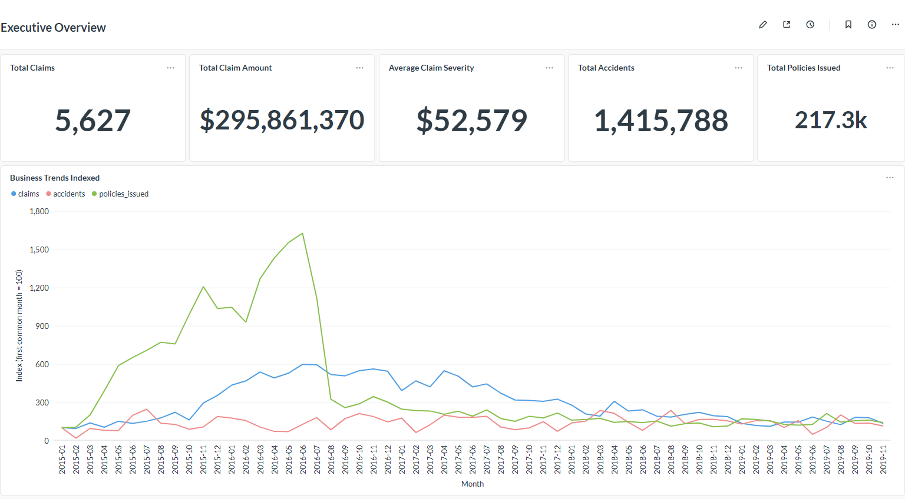
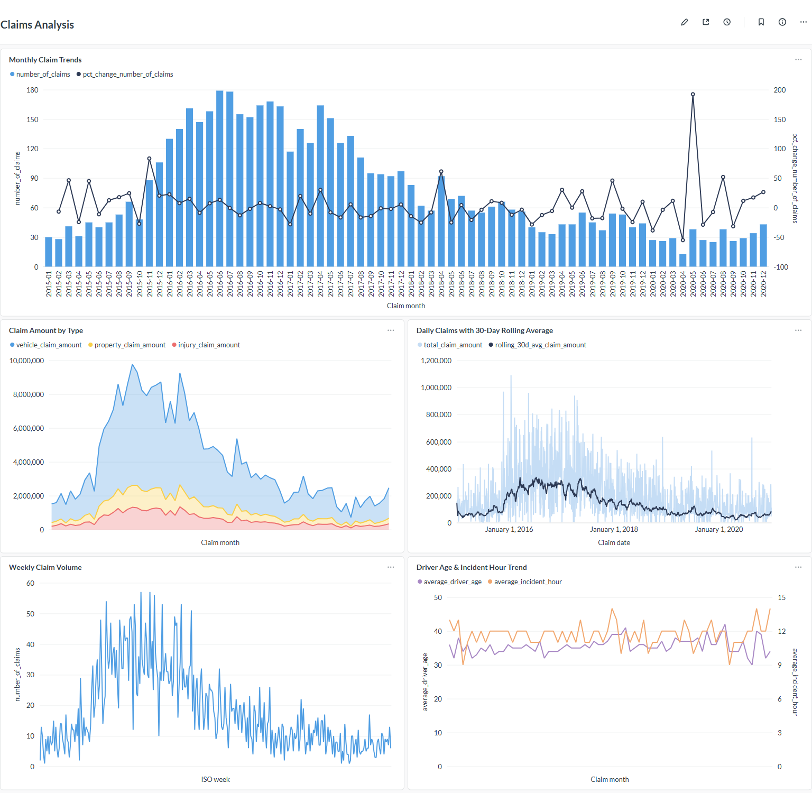
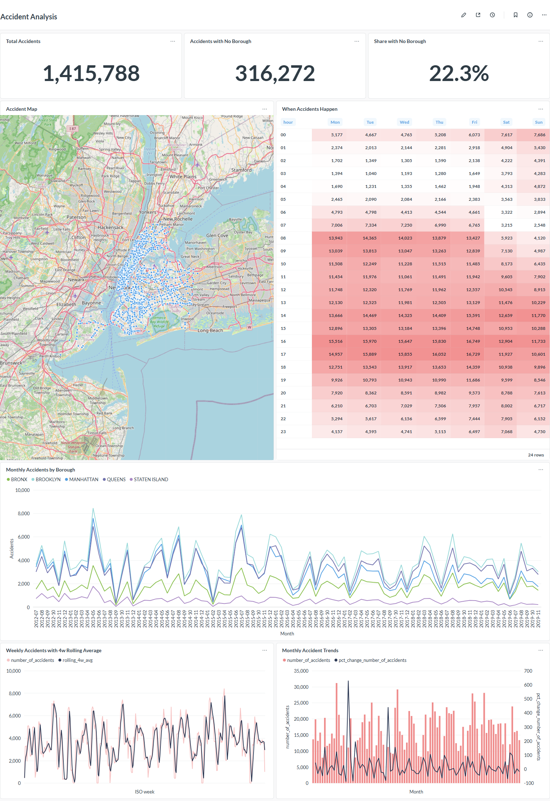
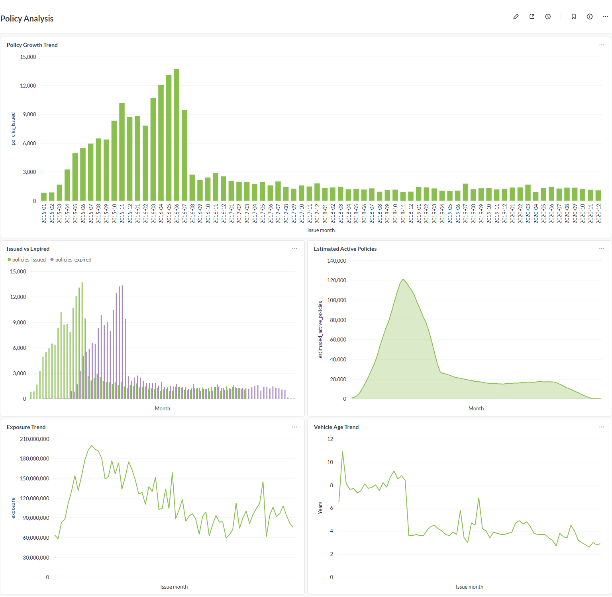
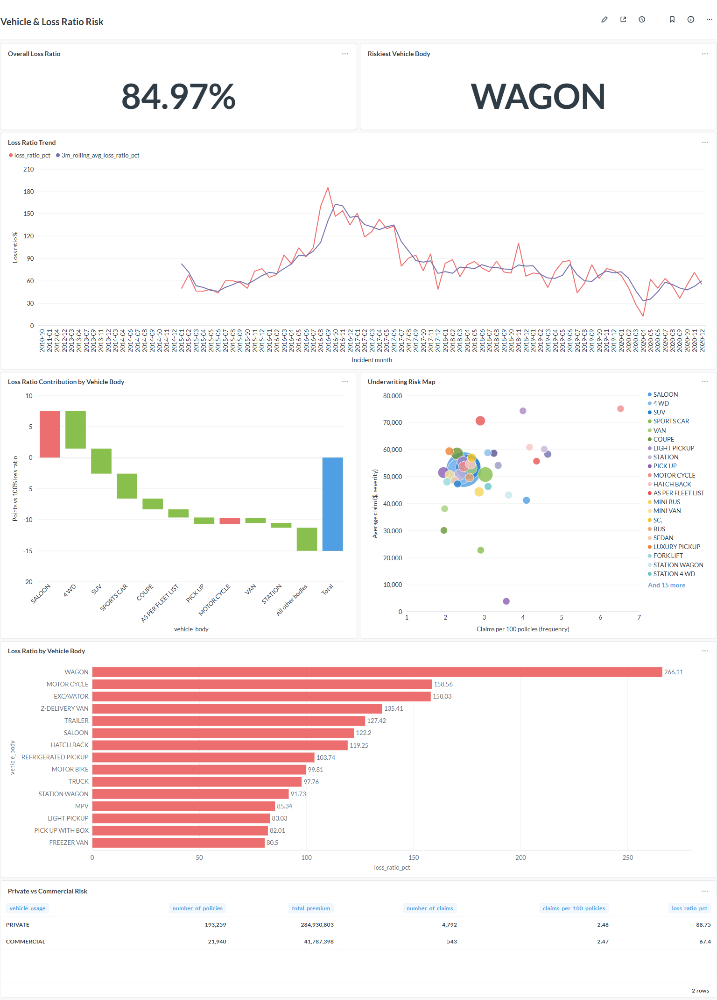
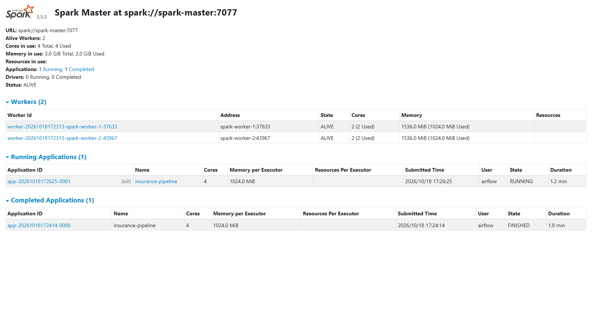

# Insurance Data Engineering Pipeline

An end-to-end data pipeline for an auto insurance book of business: it pulls policies from MySQL, claims from MongoDB, and accidents from a local copy of NYC open data (standing in for an S3 bucket), cleans and validates it, aggregates it into business-ready tables, and serves it through a set of Metabase dashboards. Runs entirely locally with Docker Compose.

## How it works

```
MySQL (policies) / MongoDB (claims) / local file standing in for S3 (accidents)
    |
    v
Bronze   — raw data, ingested as-is
    |
    v
Silver   — cleaned, standardized, typed
    |
    v
Data Quality Gate — Great Expectations checks the data before it goes further
    |
    v
Gold     — business-ready aggregates (claims, accidents, policies, loss ratio)
    |
    v
ClickHouse  →  Metabase dashboards
```

This is a [Medallion Architecture](https://www.databricks.com/glossary/medallion-architecture): each layer only cleans up after the one before it, so you can always trace a number on a dashboard back to the raw record it came from. Everything is orchestrated by Airflow.

## Tech stack

PySpark & Delta Lake for the transforms, Great Expectations for data quality, Airflow for orchestration, ClickHouse as the analytics warehouse, and Metabase for dashboards. Tested with pytest and linted with ruff/black, checked on every push via GitHub Actions.

## The data

Three domains, each from a different source, joined together for analysis:

| Domain | Source | Sample file it's seeded from | What it captures |
|---|---|---|---|
| **Policies** | MySQL | `data/samples/mysql/policies.csv` | who's insured, what vehicle, what premium, when it's active |
| **Claims** | MongoDB | `data/samples/mongodb/claims.json` | what was claimed, how much, by whom, why |
| **Accidents** | Local file, standing in for S3 | `data/samples/s3/external/accidents.csv.gz` | where and when accidents happened (a copy of NYC Open Data's Motor Vehicle Collisions data) |

Where Bronze reads from is set by `SOURCE_MODE`:

- `databases` (what the Airflow DAG uses): policies are read from the MySQL container over JDBC, and claims from the MongoDB container. Docker Compose seeds both from the sample files above.
- `files` (the default, used by the tests and CI): policies and claims are read straight from those same sample files, so there's no database to run.

Both modes load the same data. (An earlier, larger claims file, with 50,642 synthetic claims against the same policies, was dropped. It gave a loss ratio of over 700% against this policy book, so it clearly wasn't generated to match it.) Accidents always come from the local file. There's no S3 bucket involved; the `s3/` folder name just marks the file's role.

## The pipeline

**Bronze** ingests each source's raw data with minimal changes — just enough to land it as a table.

**Silver** cleans it up: parsing dates, standardizing column names, dropping rows with missing required fields or values that are obviously wrong (negative premiums, GPS coordinates outside Earth's valid range), keeping one row per policy number, and turning the source's "unknown" placeholders into nulls (see [Data-quality notes](#data-quality-notes)).

**The quality gate** runs a Great Expectations suite against every Silver table as a second check (required fields present, values in range, claim and policy numbers unique) — if anything still looks wrong, the pipeline stops here instead of letting it flow into Gold.

**Gold** turns clean data into the numbers a dashboard actually needs: daily/weekly/monthly rollups of claims and accidents, policy growth and exposure, and — the one part of this pipeline that actually connects claims back to the policies that generated them — real loss ratio and per-vehicle-segment risk.

### How the loss ratio is calculated

Every loss-ratio number on the dashboards (overall, monthly, and per vehicle segment) uses the same basis:

- **Claims**: incurred claim amounts for claims whose policy made it into Silver. A claim whose policy was dropped (for example, for a negative premium) is left out, because that policy's premium isn't in the denominator either.
- **Premium**: *written* premium. Each policy's full premium is counted in the month it was issued. This is not earned premium (premium spread over the policy term), which the pipeline doesn't compute.
- **Monthly attribution**: a claim counts toward the month of its *incident*, not the month it was filed. A month with claims but no written premium shows no loss ratio rather than 0%.

### Data-quality notes

The sample data is partly synthetic, and a few of its quirks shape the numbers:

- About half the policies (112,696 of 227,484 raw rows) have no sum insured. They're kept, so exposure totals only cover policies that have one.
- 10,199 raw policy rows have a negative premium and are dropped in Silver. 7 policy numbers appear more than once; Silver keeps one row per policy (latest issue date, then latest expiry, then highest premium).
- In the claims, a driver age of 0 and a licence date of 01-01-1900 are placeholders for "unknown". Silver turns them into nulls, so they don't drag down the average driver age.
- Only about 29% of claim incidents fall inside their policy's effective-to-expiry period (28.5% on the sample). Those claims are still counted. `gold_loss_ratio_monthly.claims_outside_policy_period` counts the rest per month, and the Gold step logs the total.

### Rolling averages

`30d_` columns on the daily tables average over 30 calendar days, with days that have no claims or accidents counted as zero. `4w_` columns on the weekly tables cover the current week plus the 3 before it. `3m_` columns on the monthly tables cover the current month plus the 2 before it. Weeks are ISO weeks, labelled by ISO week-based year (so 2016-01-01 falls in `2015-53`).

## Dashboards

Five Metabase dashboards, built entirely by `scripts/setup_metabase.py` from the SQL in `metabase_queries/` (one folder per dashboard, one `.sql` file per card; each file's header comment sets its chart type, size and settings). Every card on every dashboard has its query in the repo.

### Executive Overview
- **Total claims, total claim amount, average claim severity, total accidents, total policies issued**: headline number cards
- **Business trends (indexed)**: claims, accidents and policies issued per month, each indexed to 100 at the first month all three have data (January 2015). Raw accidents are ~200x claims, so indexing puts the three on one readable scale. Only the period where all three series exist is shown, and a month with no data is a gap, not a drop to 0.

### Claims Analysis
- **Monthly claim trends**: claim volume with month-over-month growth
- **Claim amount by type**: injury vs property vs vehicle dollars per month (stacked)
- **Daily claims with a 30-day rolling average**: day-level cost vs the smoothed trend
- **Weekly claim volume**: short spikes the monthly view smooths away
- **Driver age & incident hour trend**: is the claimant profile or time of day shifting?

### Accident Analysis
- **Total accidents / accidents with no borough / share with no borough**: 22% of accidents have no borough recorded, so they're counted here rather than silently dropped from the borough chart
- **Accident map**: the 2,000 busiest ~110 m grid cells in NYC (Gold aggregates 1.4M accidents to a 3-decimal lat/lon grid)
- **When accidents happen**: weekday x hour matrix, color-scaled so it reads as a heatmap
- **Monthly accidents by borough**: one line per borough over time
- **Weekly accidents with a 4-week rolling average** and **monthly accident trends**

### Policy Analysis
- **Policy growth trend**: new policies issued per month
- **Issued vs. expired** and **estimated active policies**: growth vs churn, and the running book size
- **Exposure trend**: total sum insured written per month
- **Vehicle age trend**: average vehicle age at issuance (1 decimal)

### Vehicle & Loss Ratio Risk
- **Overall loss ratio** and **riskiest vehicle body**: number cards (see [How the loss ratio is calculated](#how-the-loss-ratio-is-calculated))
- **Loss ratio trend**: monthly ratio and 3-month rolling ratio; months with no written premium are gaps, not 0%
- **Loss ratio contribution by vehicle body**: waterfall of how many points each body type adds to or takes off the portfolio loss ratio relative to break-even (100%); the bars add up to the portfolio ratio minus 100
- **Underwriting risk map**: bubble chart per body type (at least 20 policies): claim frequency (x) vs average claim severity (y), bubble size = written premium
- **Loss ratio by vehicle body** and **private vs. commercial risk**

## Screenshots

Generated by `scripts/screenshot_dashboards.py` (see [Running it](#running-it)).

| | |
|---|---|
| **Executive Overview**<br> | **Claims Analysis**<br> |
| **Accident Analysis**<br> | **Policy Analysis**<br> |
| **Vehicle & Loss Ratio Risk**<br> | **Spark cluster** (master UI during a DAG run)<br> |

## Performance

The sample data is small, so `scripts/scale_data.py` builds 5x, 10x and 20x copies of it, rewriting only the keys so that joins, dedup and the quality checks behave exactly as on the original. `scripts/benchmark.py` then times each step with Spark event logging on, and `scripts/analyze_event_log.py` shows where the time goes.

The baseline's biggest costs all traced back to the gzipped accidents file. gzip can't be split, so the file was read twice by a single task: once just to infer the schema, once for real. Great Expectations was also caching every Silver table in full before validating it. Fixing what the measurements pointed to, without changing a single Gold value on the sample data:

| scale | before | after |
|---|---:|---:|
| x5 | 514 s | 405 s (−21%) |
| x10 | 723 s | 565 s (−22%) |
| x20 | fails (out of memory in the quality step) | 837 s |

The optimized code also runs at every scale on the Docker Compose Spark cluster (2 workers × 2 cores), including x20 in 826 s.

[docs/benchmark.md](docs/benchmark.md) has the full write-up: per-step before/after tables, why each change helped, what was tried and left out, and how Gold was verified unchanged.

## Project layout

```
├── src/insurance_pipeline/   # all the transform logic — Bronze, Silver, quality, Gold, ClickHouse load
├── dags/                     # the Airflow DAG
├── docker/                   # Dockerfiles and seed SQL for the local stack
├── tests/                    # pytest suite, runs against a local Spark session
├── metabase_queries/         # the SQL behind every dashboard card
├── data/                     # sample source data + the schemas used to clean it
├── scripts/                  # Metabase setup/screenshots, and the scale benchmark tooling
├── docs/                     # benchmark write-up and its raw results
├── docker-compose.yml
└── pyproject.toml
```

## Running it

### Locally with Docker Compose (recommended)

```bash
docker compose up -d --build
docker compose exec airflow-webserver airflow dags trigger insurance_pipeline_dag
```

This brings up Airflow (http://localhost:8080, admin/admin), MySQL and MongoDB seeded with the sample data, and ClickHouse. Airflow waits until both databases have finished seeding. The DAG runs with `SOURCE_MODE=databases`, so Bronze reads policies and claims from those two containers. Once the DAG finishes, check the results:

```bash
docker compose exec clickhouse clickhouse-client --query "SELECT * FROM insurance.gold_claims_monthly"
```

Metabase runs at http://localhost:3000. Build every dashboard from `metabase_queries/` with one command, no clicking: put an admin email and password of your choice in `.env` (see `.env.example`; `.env` is git-ignored), then

```bash
pip install requests
python scripts/setup_metabase.py          # first-time setup, ClickHouse connection, collections, cards, dashboards
```

It's idempotent: re-running updates the existing cards and dashboards in place, and archives cards whose `.sql` file was deleted. To regenerate the screenshots in `images/`:

```bash
pip install playwright && playwright install chromium
python scripts/screenshot_dashboards.py   # PLAYWRIGHT_CHANNEL=chrome to use an installed Chrome instead
```

### On a multi-node Spark cluster

By default every DAG task runs Spark in local mode inside the Airflow container. The `cluster` profile adds a standalone Spark cluster (1 master + 2 workers, built from the same image as Airflow, so Spark 3.5.3 and Python 3.11 match the driver exactly) and points the pipeline at it:

```bash
SPARK_MASTER=spark://spark-master:7077 docker compose --profile cluster up -d --build
docker compose exec airflow-webserver airflow dags trigger insurance_pipeline_dag
```

(PowerShell: `$env:SPARK_MASTER="spark://spark-master:7077"` first.) The Spark master UI is at http://localhost:8090. Each worker offers 2 cores and 1.5 GB to one 1 GB executor; the driver runs inside the Airflow task with 2 GB. With Airflow, the three databases, Metabase and the cluster all running, give Docker **at least 8 GB of RAM** (verified on 8 GB). Workers mount the warehouse volume and `./data` at the same paths as Airflow, so executors read sources and write Delta files directly. On the sample data, a cluster run produces the same row count in every Gold table as local mode.

The ClickHouse table definitions (`docker/clickhouse/init.sql`) and the MySQL/MongoDB seeds only run when their volume is first created. After pulling changes to any of them, recreate the volumes with `docker compose down -v` before `docker compose up`.

### Local development, without Docker

```bash
python -m venv .venv && .venv/bin/pip install -e ".[dev]"
pytest -q
ruff check . && black --check .

# Run the pipeline (or one step: bronze, silver, quality, gold, clickhouse) against the sample files
python -m insurance_pipeline.run all
```

Local runs default to `SOURCE_MODE=files`. To read from your own MySQL/MongoDB instead, set `SOURCE_MODE=databases` and the `MYSQL_*`/`MONGO_*` variables listed in `.env.example`.

Needs a JDK (11 or 17) on your `PATH` for PySpark. On Windows you'll also need `winutils.exe` for Delta Lake — Docker Compose sidesteps this entirely and is the easier path.
